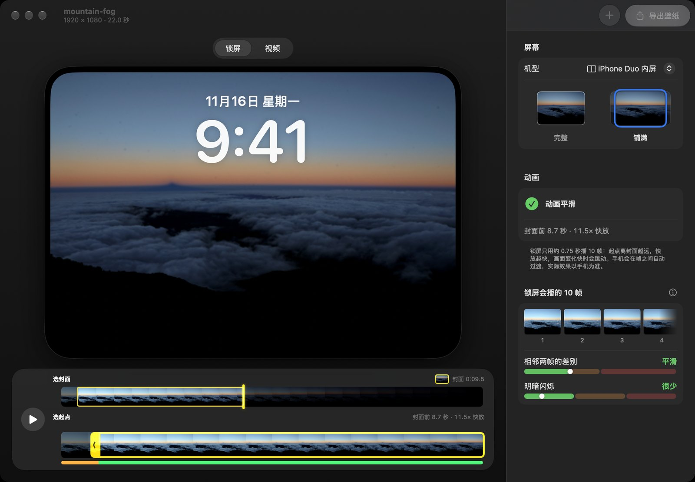

<div align="center">


# LiveWall

**把一段视频做成在 iPhone 锁屏上真正会动的实况壁纸**

[](https://github.com/ohhcarina/livewall-mac/releases/latest)


[](LICENSE)

[下载](https://github.com/ohhcarina/livewall-mac/releases/latest) · [用法](#用法) · [常见问题](#常见问题) · [从源码构建](#从源码构建) · [English](#english)



</div>

## 为什么做它

iOS 17 起，锁屏可以用实况照片当壁纸，点亮屏幕时动一下。可自己做的实况常常提示「动态效果不可用」，只能当静态图用；能动的也经常一跳一跳，或者播完那一下颜色发青。

原因是锁屏对视频有一套没写在文档里的规则：只播封面前的 10 帧，最后几帧要一步步靠近封面，单帧数据量、分辨率、色彩标签都有上限。LiveWall 是在真机上一轮一轮测出这些规则之后做成的，你只管挑片段，剩下的它来做。

## 特性

- **真正会动**：按真机测出的规则挑帧、编码，导出的壁纸点亮锁屏就动，不会只剩一张静态图。
- **自动挑最顺的一段**：你选封面，起点会自动放在封面前 20 秒内「最远还顺」的地方，也可以自己拖。
- **所见即所得**：锁屏预览带时间和日期，颜色条标出平滑、略有跳动、跳动明显，还会提示明暗闪烁。
- **不偏色**：封面和视频都按 Display P3 写，动画结束时不会突然发青。
- **适配多种屏幕**：面容 ID iPhone（默认）、iPhone Duo 内屏、iPhone SE、iPad、自定义比例；画面可以选「完整」（压窄，不丢内容）或「铺满」（裁切，不变形）。
- **裁掉黑边**：在「视频」里拖黄色裁切框，去掉上下黑边或不要的部分（按住 ⇧ 保持比例，⌥ 两边一起收）。
- **逐帧选封面和起点**：拖封面或起点时按住不动，时间轴放大到逐帧；停住时预览换成原片里那一帧。
- **长视频也快**：4K、240 fps、十几分钟的航拍，打开一两秒就能编辑；编辑用的小副本在后台做，拖动不卡，导出仍用原片。
- **细节多的素材也能动**：4K 航拍这类画面会自动压低单帧数据量，避免超出锁屏的上限。
- **纯本地**：不联网、不收集任何数据；只依赖系统框架，不需要 ffmpeg。

## 下载

到 [Releases](https://github.com/ohhcarina/livewall-mac/releases/latest) 下载 `LiveWall-<版本>.dmg`，把 LiveWall 拖进「应用程序」。

- macOS 14 或更新，Apple 芯片和 Intel 都可以。
- 已用 Developer ID 签名并经过 Apple 公证，双击就能打开。

## 用法

1. 把视频拖进窗口。
2. 在右边选机型和适配方式（完整 / 铺满）。视频有黑边的话，切到「视频」拖黄色框裁掉。
3. 在「选封面」那一行选停住的那一帧。锁屏点亮时只播它之前的 10 帧。
4. 起点会自动放好，想要更长的动作就在「选起点」那一行往前拖（按住不动可以逐帧选，拖过左端会显示更早的部分），颜色条会告诉你顺不顺。
5. 点「导出壁纸」，在弹窗里选「隔空投送」到 iPhone，或者「添加到『照片』」等 iCloud 同步。
6. 在 iPhone 上打开「设置 › 墙纸 › 添加新墙纸 › 照片」，选这张实况。

> 预览只是模拟。手机会在帧之间自己补画面，实际效果以手机为准。

## 常见问题

<details>
<summary><b>设成壁纸时还是提示「动态效果不可用」？</b></summary>

先确认导入的是 LiveWall 导出的那一份（隔空投送或「照片」同步），不是经过微信、网盘等压缩过的版本。如果还是不行，请[开一个 issue](https://github.com/ohhcarina/livewall-mac/issues/new)，写上 iPhone 机型、iOS 版本，最好附上导出的 `.pvt`。
</details>

<details>
<summary><b>支持哪些 iPhone？</b></summary>

真机验证过 iPhone Duo（内屏）和 iPhone 16 Pro（竖屏）。其他面容 ID 机型的屏幕比例几乎一样，应该也能用；iPad 还没在真机上测过。
</details>

<details>
<summary><b>iPhone 拍的 HDR（杜比视界）视频能用吗？</b></summary>

可以。从 1.1.0 起导入时会按系统的方式转成普通画质（SDR）再做壁纸，锁屏实况壁纸本来就是 SDR。转换后的颜色还没在真机上逐一核对过，如果和原片差得明显，欢迎开 issue。
</details>

<details>
<summary><b>为什么锁屏上只动一下就停了？</b></summary>

这是 iOS 的设计：锁屏实况只在点亮屏幕时播封面之前的 10 帧（约 0.75 秒），然后停在封面上。所以要把想看的动作放进封面之前那一小段。
</details>

## 在 iPhone 上直接做

iOS 版「LiveWall 实况壁纸」正在准备上架 App Store：在手机上选视频，直接存成会动的实况壁纸，不用经过 Mac。

## 从源码构建

需要 Xcode 27 或更新。

```bash
cd app
swift test                    # 引擎的单元测试
swift run LiveWall            # 直接运行（也可以 swift run LiveWall 视频文件）
scripts/build-app.sh          # 组装 dist/LiveWall.app（通用二进制，ad-hoc 签名）
scripts/make-dmg.sh           # 打成 dist/LiveWall-<版本>.dmg
```

| 目录 | 内容 |
|---|---|
| `app/Sources/LiveWallCore` | 引擎：取帧、挑帧、色彩、HEVC 编码、HEIC 封面、实况元数据。纯 Swift，只用 AVFoundation、VideoToolbox、ImageIO |
| `app/Sources/LiveWall` | Mac App（SwiftUI） |
| `app/Sources/livewall-cli` | 命令行，能批量出包 |

命令行示例：

```bash
swift run livewall-cli build <视频> --range 起,止 --aspect 0.4613 --name 名字 --out 输出目录
```

`--range` 是起止秒数（止 = 封面），`--aspect` 是屏幕宽高比，`--mode crop` 改成裁切；不带参数运行 `swift run livewall-cli` 会列出全部命令。

## 致谢与许可

[MIT](LICENSE)。实况元数据的写法来自 [pudding0503/live-photo-batch](https://github.com/pudding0503/live-photo-batch)（MIT），许可见 [THIRD_PARTY/](THIRD_PARTY/)。测试样片的来源与许可见 [app/Samples/README.md](app/Samples/README.md)。

---

## English

**LiveWall turns a video clip into a Live Photo wallpaper that actually moves on the iPhone lock screen.**

Most home-made Live Photos end up as "Motion not available", or they stutter and shift colour when the lock screen plays them. The lock screen follows a set of undocumented rules: it plays only the 10 frames before the key photo, the last steps must ease into it, and there are limits on frame size, resolution and colour tags. LiveWall was built after working those rules out on real iPhones. You pick the moment; it picks the frames, encodes them and checks the result. Long 4K high-frame-rate clips open in seconds.

- Download the notarized `.dmg` from [Releases](https://github.com/ohhcarina/livewall-mac/releases/latest). macOS 14 or later, Apple silicon and Intel.
- The interface is in Chinese.
- Fully local, no network access, no data collected.
- Build from source: `cd app && swift run LiveWall` (Xcode 27+).

MIT licensed.
